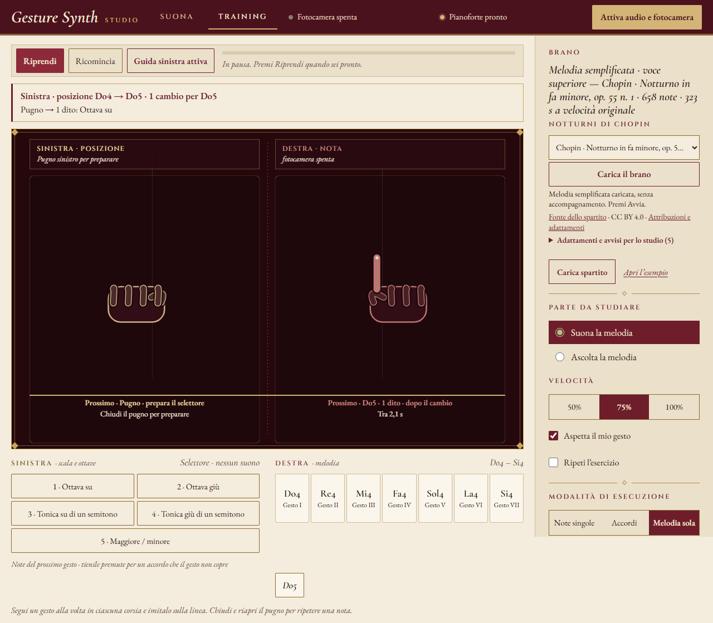

# Gesture Synth

**Suona con le mani. Studia un brano, un gesto alla volta.**

Gesture Synth trasforma la fotocamera del tuo dispositivo in un controllo
musicale. Alza le dita per scegliere le note, chiudi il pugno per fermarle e
segui le mani guida per esercitarti su un brano. Puoi anche suonare toccando
i tasti sullo schermo.

**[Apri Gesture Synth nel browser](https://soldo07.github.io/gesture-synth-web/)**

Gratuito, senza account e senza installazione. Disponibile da computer,
tablet e telefono; per la versione online non serve tenere acceso un PC.

*Il Training mostra le dita da alzare e prepara il gesto successivo.
Nell'immagine: studio della melodia del Notturno in fa minore di Chopin.*

## Comincia a suonare

1. **Apri l'app e scegli uno strumento.** Per una prima prova puoi lasciare
   Pianoforte e Note singole, già selezionati.
2. **Tocca «Attiva audio e fotocamera»** e consenti l'accesso alla camera.
   Inquadra entrambe le mani con i palmi rivolti verso la fotocamera,
   le dita ben separate e una buona illuminazione.
3. **Alza l'indice per suonare una nota.** Cambia combinazione per cambiare
   nota; chiudi il pugno per interromperla. Per ripetere la stessa nota,
   chiudi e riapri il pugno.

Vuoi provare prima i suoni? **Tocca direttamente i tasti sullo schermo**:
puoi usarli anche senza attivare la fotocamera. Per fermare tutto premi
**«Ferma tutti i suoni»**, che interrompe anche il Training e spegne la camera.

Al primo utilizzo attendi il caricamento del riconoscimento delle mani e
dei suoni scelti, soprattutto con una connessione mobile.

## Cinque strumenti

| Strumento | Cosa puoi esplorare |
| --- | --- |
| **Pianoforte** | Note singole, melodia e accordi con diverse disposizioni. |
| **Flauto dolce** | Melodie con un suono sostenuto e registri diversi. |
| **Violino** | Linee melodiche con note tenute. |
| **Tromba** | Frasi melodiche con timbro di ottone. |
| **Batteria** | Cassa, rullante, hi-hat, piatti e tom. |

I suoni utilizzano campioni audio di strumenti. Volume e registri si
regolano dal pannello laterale, il **leggio**.

## Scegli come usare le mani

| Modalità | Mano sinistra | Mano destra |
| --- | --- | --- |
| **Note singole** | Suona una nota nel proprio registro. | Suona una nota nel proprio registro. |
| **Melodia sola** | Cambia ottava, tonalità e scala, senza produrre suono. | Suona la melodia. |
| **Accordi**, al pianoforte | Sceglie la nota di partenza dell'accordo. | Sceglie la disposizione delle voci. |

**Note singole** è il punto di partenza per esplorare i suoni e suonare con
due mani indipendenti. **Melodia sola** permette di raggiungere registri
più gravi o più acuti usando i gesti della sinistra. **Accordi** dedica
entrambe le mani alla costruzione dell'accompagnamento.

La batteria usa Note singole: i gesti attivano le diverse percussioni.

### Le sette combinazioni delle note

Per gli strumenti melodici, le combinazioni selezionano le sette note
della scala. Ecco un esempio in **Do maggiore**:

| Dita alzate | Nota |
| --- | --- |
| Indice | Do |
| Indice e medio | Re |
| Indice, medio e anulare | Mi |
| Indice, medio, anulare e mignolo | Fa |
| Tutte e cinque | Sol |
| Indice e mignolo | La |
| Pollice, indice e mignolo | Si |
| Nessuna: pugno chiuso | Silenzio |

Le note cambiano con la scala e, in Melodia sola, con la tonalità
selezionata. Mantieni la combinazione per tenere la nota. Il pugno ferma
il suono della mano che sta suonando.

<strong>Come spostarti sulla tastiera in Melodia sola</strong>

La destra continua a usare le sette combinazioni delle note. Con la
sinistra scegli dove si trova la melodia sulla tastiera, usando le
combinazioni delle prime cinque righe della tabella:

| Gesto sinistro | Comando |
| --- | --- |
| 1 dito | Un'ottava più in alto |
| 2 dita | Un'ottava più in basso |
| 3 dita | Tonalità su di un semitono |
| 4 dita | Tonalità giù di un semitono |
| 5 dita | Alterna scala maggiore e minore |

Prima di ogni comando **chiudi brevemente il pugno sinistro**, poi tieni
il gesto per circa **0,3 secondi**. Per un altro cambio torna al pugno:
mantenere un gesto fermo esegue un solo comando. Un semitono è il passo
tra due tasti consecutivi, bianchi o neri, della tastiera.

Il registro complessivo va da **La0 a Do8**, come gli 88 tasti del pianoforte.
Nel Training la guida sinistra indica quali cambi preparare.

<strong>Come costruire gli accordi al pianoforte</strong>

La sinistra sceglie la nota di partenza con le sette combinazioni. La
destra decide la disposizione delle voci: **1 dito** per la posizione base,
**2** per il primo rivolto, **3** per la settima, **4** per la dominante
(diminuita in minore). Questi comandi destri usano indice, medio, anulare e
mignolo; il **pollice destro** abbassa l'accordo di un'ottava.

Chiudi il pugno destro per fermare l'accordo. In questa modalità la
destra controlla l'armonia; per eseguire una melodia indipendente scegli
Note singole.

## Training: impara seguendo i gesti

Nel **Training** lo schermo di esecuzione è diviso in due corsie affiancate.
In ciascuna scende **una sola mano guida alla volta**, dall'alto verso una
linea comune: imita il gesto quando la raggiunge. Con **«Aspetta il mio gesto»**
la guida resta sulla linea finché esegui l'attacco richiesto; durante Pausa
le figure rimangono ferme. Le due guide
hanno ruoli precisi in Melodia sola:

- **Sinistra: posizione sulla tastiera.** Ti indica il pugno di preparazione
  e i cambi di ottava, tonalità o scala.
- **Destra: nota da suonare.** Ti mostra la combinazione di dita e il nome
  della nota da eseguire dopo il cambio.

### La tua prima sessione

1. Apri **Training**: con uno strumento melodico parte da Melodia sola.
2. Premi **«Apri l'esempio»** per un esercizio breve, oppure scegli un
   Notturno e premi **«Carica il brano»**.
3. Lascia selezionato **«Aspetta il mio gesto»** e scegli la velocità
   **50%** per iniziare con calma.
4. Premi **«Avvia»**. Prepara la posizione con la sinistra e suona la nota
   con la destra; il brano attende l'esecuzione richiesta prima di avanzare.

Puoi mettere in pausa, ricominciare e ripetere l'esercizio. La velocità
si può portare al **75%** o al **100%** quando conosci meglio i gesti.

### Aggiungi l'accompagnamento quando sei pronto

In **Melodia sola** studi soltanto la melodia, con la sinistra dedicata ai
cambi di posizione. Per esercitarti con l'accompagnamento automatico,
scegli **Note singole** e **«Destra · sinistra automatica»**. Puoi poi
studiare la sinistra con la destra automatica, scegliere entrambe le mani
o ascoltare il brano.

## Un primo repertorio: sette Notturni di Chopin

La biblioteca integrata include:

- Notturno in **fa minore, op. 55 n. 1**.
- Notturno in **si bemolle minore, op. 9 n. 1**.
- Notturno in **do diesis minore, op. 27 n. 1**.
- Notturno in **do minore, op. 48 n. 1**.
- Notturno in **mi minore, op. 72 n. 1** — n. 19.
- Notturno in **do diesis minore, B. 49** — n. 20, postumo.
- Notturno in **do minore, B. 108** — n. 21, postumo.

In Melodia sola il Training ricava una **versione semplificata dalla voce
superiore**, senza accompagnamento. Scegliendo Note singole ritrovi le
parti complete dello spartito preparato per il Training. Gli adattamenti
e gli ornamenti non sviluppati sono dichiarati negli avvisi di ogni brano.

### Porta un tuo spartito

Usa **«Carica spartito»** per aprire un file **MusicXML non compresso**,
con estensione `.musicxml` o `.xml`, fino a 5 MB. Il file contiene note,
durate e indicazioni di tempo; puoi esportarlo da un programma di notazione.

MIDI e MXL compressi non sono accettati dall'importatore: esporta una
versione MusicXML non compressa, con ripetizioni e ornamenti scritti per
esteso. Il tuo spartito viene letto nel browser.

## Dispositivo e riservatezza

- Usa un browser aggiornato su computer, tablet o telefono. La precisione
  dei gesti dipende dalla fotocamera, dalla luce e dalla visibilità delle dita.
- Se la fotocamera non è disponibile, usa i **tasti sullo schermo**.
- Il video è elaborato **sul dispositivo**: le immagini non vengono inviate
  al server per riconoscere le mani.
- **Pausa**, **«Ferma tutti i suoni»** e il passaggio della pagina in
  background spengono la camera. Puoi usare anche **«Spegni fotocamera»**.

## Cosa aspettarti dall'esperienza

Gesture Synth insegna a usare un **controllo musicale gestuale**. Le
combinazioni delle dita non corrispondono alla diteggiatura di un pianoforte,
di un flauto o di un violino reale. I suoni campionati permettono di esplorare
timbri diversi; articolazioni e dinamiche restano più semplici di quelle
degli strumenti acustici.

Alcune note fuori scala e alcuni accordi non sono raggiungibili con il gesto
scelto: il Training li segnala e offre i **tasti del brano** per eseguirli.
Per iniziare, l'esercizio incluso è più accessibile dei Notturni completi.

## Crediti e licenze

Gesture Synth deriva dal progetto originale di **[Eric Wei](https://indecisiveeric.com)**.
È destinato a uso **personale, educativo e non commerciale**:
leggi la [licenza del progetto](licenses/Gesture-Synth-LICENSE.txt).

I campioni audio provengono da FluidR3 GM; il riconoscimento delle mani
utilizza MediaPipe. Sono inclusi i caratteri Cormorant Garamond, EB Garamond
e Cinzel. Per attribuzioni, licenze e adattamenti consulta
[suoni](SOUND-LICENSES.txt), [componenti e caratteri](licenses/README.txt)
e [spartiti](brani/SOURCES.txt).
